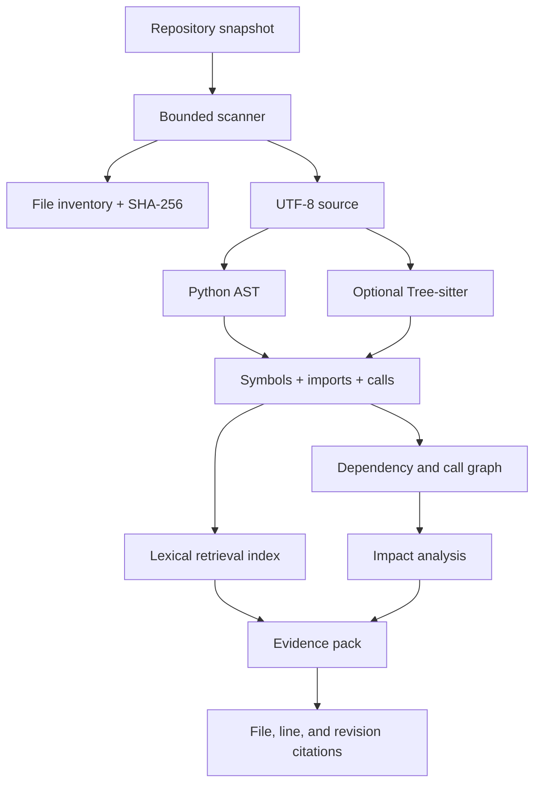

# RepoAtlas AI

> **Understand any codebase. Follow the evidence. Make safer engineering decisions.**

[](https://github.com/archivesofkrish/repoatlas-ai/actions/workflows/ci.yml)
[](https://www.python.org/)
[](LICENSE)

RepoAtlas AI is a read-only codebase intelligence workbench. It inventories repositories, extracts source structure, builds dependency and call-reference graphs, retrieves line-addressable evidence, and estimates the files affected by a change. It is designed around a simple rule: engineering explanations should be inspectable against the exact source that produced them.

**Current release:** `0.2.0` — multi-language static analysis, graph construction, impact analysis, evidence search, CLI, and local API. The current answering workflow is retrieval-first; it does not yet generate conclusions with an LLM.

## Why RepoAtlas?

Understanding a large or unfamiliar repository is expensive. Search can find text but not reliably explain module relationships. A language model can produce fluent explanations but may miss files, mix revisions, or invent implementation details. RepoAtlas combines deterministic code analysis and source evidence so developers can answer questions and investigate changes with a verification trail.

## Features

| Capability | Implemented behaviour |
|---|---|
| Bounded repository scanner | Reads regular UTF-8 text files under file-count and byte limits; excludes generated folders, sensitive filenames, symlinks, and binary content |
| Python analysis | Uses the standard-library AST to extract classes, functions, nested definitions, imports, calls, and docstrings without importing project modules |
| Multi-language analysis | Optional Tree-sitter adapters for JavaScript, TypeScript, Go, Rust, Java, C, C++, Ruby, and C# |
| Dependency graph | Builds file import edges and best-effort symbol call-reference edges with source line provenance |
| Change-impact analysis | Traverses reverse, statically resolved import relationships to find likely dependent files |
| Lexical retrieval | Ranks files and source lines with deterministic term-frequency/inverse-document-frequency scoring |
| Evidence packs | Returns file path, line range, commit SHA, excerpt, match reason, and explicit retrieval limitations |
| Credential hygiene | Excludes common sensitive filenames and redacts several common token patterns in returned excerpts |
| Interfaces | CLI and optional FastAPI service with scan, search, ask, graph, and impact endpoints |

The multi-language parser is an optional capability. Install and cache grammars explicitly; repository scans do not download parser code or execute project code.

## Quick start

Requires Python 3.11 or newer.

```bash
git clone https://github.com/archivesofkrish/repoatlas-ai.git
cd repoatlas-ai

python -m venv .venv
source .venv/bin/activate       # Windows: .venv\\Scripts\\activate
python -m pip install --upgrade pip
pip install -e '.[dev,api]'
```

Download the grammars you plan to analyse. This is an explicit setup action:

```bash
python -c "from tree_sitter_language_pack import download; download(['javascript', 'go', 'rust', 'java'])"
```

Then analyse any repository:

```bash
repoatlas scan /path/to/repository
repoatlas search /path/to/repository "authentication token validation" --top-k 8
repoatlas ask /path/to/repository "Where is authentication implemented?"
repoatlas graph /path/to/repository
repoatlas impact /path/to/repository src/core/auth.py
```

The core scanner and Python AST analyser use the Python standard library. Tree-sitter grammars are downloaded only by the explicit command above (or an equivalent operator-managed setup step).

## CLI reference

### Scan

```bash
repoatlas scan PATH
repoatlas scan PATH --json
```

Produces a file inventory, symbol list, import and call references, excluded-file counts, warnings, and Git revision.

### Search

```bash
repoatlas search PATH "query terms" --top-k 8
```

Returns ranked source excerpts with exact file paths and best-matching line numbers. Identifier splitting allows a query such as `create user` to match `create_user`. Ranking is deterministic lexical retrieval, not embedding-based semantic search.

### Ask

```bash
repoatlas ask PATH "How does authentication work?" --top-k 6
```

Creates a JSON evidence pack. In this release, the `answer` field deliberately explains that the evidence must be reviewed; it is not generated prose from an LLM. This prevents the product from presenting retrieval as verified reasoning.

### Graph

```bash
repoatlas graph PATH
```

Outputs graph nodes, import edges, call-reference edges, resolution flags, and aggregate counts. Unresolved references remain visible instead of being silently treated as confirmed internal dependencies.

### Impact

```bash
repoatlas impact PATH path/to/module.py --max-depth 5
```

Traverses reverse resolved-import edges and reports direct and transitive dependants. This is a static estimate, not a guarantee of runtime blast radius.

## Optional HTTP API

Install the API extra and start the service with an explicit workspace root:

```bash
pip install -e '.[api,parsing]'
REPOATLAS_ROOT=/path/to/workspace uvicorn repoatlas.api:app --host 127.0.0.1 --port 8000
```

| Endpoint | Purpose |
|---|---|
| `GET /health` | Health and read-only mode |
| `POST /v1/scan` | Scan a repository under the configured root |
| `POST /v1/search` | Retrieve line-addressable evidence |
| `POST /v1/ask` | Create a question evidence pack |
| `POST /v1/graph` | Build dependency and call-reference graph |
| `POST /v1/impact` | Estimate likely file impact |

Example graph request:

```bash
curl -s http://127.0.0.1:8000/v1/graph \\
  -H 'content-type: application/json' \\
  -d '{"path":"my-project"}'
```

The API confines requested paths to `REPOATLAS_ROOT`. It is a local development interface, not a production multi-tenant service. Add authentication, authorization, rate limits, worker isolation, and operational controls before network exposure.

## Architecture



### Source layout

```text
src/repoatlas/
├── analyzer.py   # Snapshot scan, Python AST, multi-language integration
├── api.py        # FastAPI routes and root confinement
├── cli.py        # scan, search, ask, graph, impact
├── graph.py      # Dependency graph and transitive impact analysis
├── models.py     # Typed repository and analysis models
├── parsing.py    # Optional Tree-sitter language adapters
├── qa.py         # Evidence-pack assembly and citation validation
├── scanner.py    # Bounded, read-only file discovery
├── search.py     # Deterministic lexical retrieval
└── security.py   # Heuristic secret detection and redaction
```

## Safety model and known limitations

RepoAtlas treats repository content as untrusted input.

- It does **not** import or execute repository code during scanning or static analysis.
- It does not follow directory symlinks; file symlinks are excluded.
- Default scan limits are 20,000 files, 1 MB per file, and 100 MB total content.
- Common generated directories, sensitive filenames such as `.env`, and credential stores such as `.aws`, `.ssh`, and `.config/gcloud` are excluded.
- Tree-sitter grammar installation is explicit. A scan never downloads a grammar.
- The API resolves paths beneath `REPOATLAS_ROOT` and rejects path traversal.
- Secret detection is heuristic and incomplete. It cannot guarantee that every credential has been removed.
- Language grammars expose different syntax trees. The generic adapter captures common definitions, imports, and calls but does not promise complete language-semantic understanding.
- Import resolution is best-effort. Dynamic imports, macros, generated code, module aliases, build-system rules, dependency injection, and runtime reflection are not fully modelled.
- Call-reference edges are name-based and marked resolved only when a unique symbol candidate exists.
- Impact analysis follows statically resolved file imports only; it is not a complete runtime blast-radius calculation.
- Search is lexical and can miss relevant code described using different terminology.

See [SECURITY.md](SECURITY.md) for reporting guidance and [CONTRIBUTING.md](CONTRIBUTING.md) for engineering standards.

## Testing and quality

```bash
ruff check src tests
pytest --cov=repoatlas --cov-report=term-missing
```

CI runs on Python 3.11, 3.12, and 3.13. It installs the development dependencies, explicitly caches the language grammars used by parsing tests, runs Ruff, and executes the test suite with coverage reporting.

The tests use temporary repositories and synthetic source fixtures; no personal or proprietary code is required.

## Roadmap

| Stage | Capability | Status |
|---|---|---|
| 1 | Safe scanner, Python AST, lexical evidence packs, CLI, local API, tests, CI | Implemented |
| 2 | Tree-sitter multi-language parsing, import/call graph, transitive impact | Implemented in current feature branch |
| 3 | Hybrid retrieval, graph-aware ranking, benchmark corpus, retrieval evaluation | Next |
| 4 | Optional model-provider abstraction with claim-to-citation validation | Planned |
| 5 | Interactive architecture explorer and investigation dashboard | Planned |
| 6 | Incremental indexing, secure workspaces, and CI/IDE integrations | Planned |

The product will add generative answers only after retrieval quality and citation correctness can be evaluated independently.

## Contributing

Bug reports and pull requests are welcome. Contributions should include tests, document limitations, and preserve the read-only default. See [CONTRIBUTING.md](CONTRIBUTING.md).

## License

MIT — see [LICENSE](LICENSE).

---

**RepoAtlas AI's central promise:** the goal is not to make AI sound like it understands a codebase. The goal is to make its understanding inspectable.
