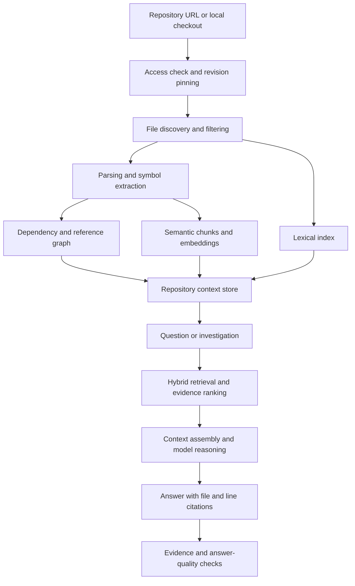

# RepoAtlas AI

> **Understand any codebase. Follow the evidence. Make safer engineering decisions.**

RepoAtlas AI is a planned, evidence-grounded codebase intelligence assistant. It helps developers understand unfamiliar repositories, discover how components interact, investigate engineering risks, and estimate the impact of proposed changes. Instead of producing answers from a repository name or a handful of loosely related snippets, RepoAtlas builds a navigable model of a specific repository revision and ties its explanations to source evidence.

**Project status:** Concept and repository specification. This repository intentionally starts with this README only; implementation has not begun.

---

## 1. The problem

Understanding a large or unfamiliar software repository is expensive. A developer may need to read dozens of files before answering basic questions:

- Where does the application start, and what happens after startup?
- Which modules call a particular function or depend on a particular interface?
- Where are authentication, authorization, input validation, and secret handling implemented?
- What happens when two requests execute at the same time?
- Which tests cover a critical path, and which important behaviours are untested?
- If a function or API changes, which components, tests, and documents might be affected?
- Does the documentation still describe the code that actually exists?

Traditional search finds matching text, but it does not reliably explain relationships. A general-purpose AI assistant can explain code, but without disciplined retrieval it may overlook files, mix versions, or confidently invent details.

RepoAtlas AI is designed to bridge that gap: **repository-aware retrieval + structural code intelligence + evidence-linked AI explanations**.

## 2. The proposed solution

RepoAtlas analyses a pinned repository revision and creates a structured, searchable representation of it. A user can then ask natural-language questions or run focused engineering investigations.

Every substantive answer should identify the source evidence that supports it: repository-relative file paths, line ranges, symbol names, and the exact commit being analysed. When evidence is missing or ambiguous, the system should say so rather than fill the gap with speculation.

### Core capabilities

| Capability | What it should do | Example question |
|---|---|---|
| Repository orientation | Summarise purpose, languages, entry points, major directories, and build/test commands | “Give me a guided tour of this repository.” |
| Architecture discovery | Identify modules, components, interfaces, dependencies, and important execution paths | “Trace a request from the API endpoint to the database.” |
| Code Q&A | Answer questions using retrieved source and structural context, with citations | “Where is the session token validated?” |
| Engineering risk review | Surface review candidates involving security, reliability, concurrency, and maintainability | “Where could untrusted input reach a sensitive operation?” |
| Change-impact analysis | Find callers, dependants, related tests, and documentation likely affected by a change | “What might break if this interface changes?” |
| Test intelligence | Map tests to code paths and identify areas with weak or unclear coverage | “Which tests exercise this authentication flow?” |
| Documentation drift | Compare documented commands, components, and configuration with repository evidence | “Which README instructions appear outdated?” |
| Learning mode | Explain a code path from beginner-friendly concepts through implementation details | “Explain this module step by step.” |

These are intended capabilities, not claims that the current repository already implements them.

## 3. Design principles

1. **Evidence before fluency.** A plausible explanation is not enough. Important claims must be traceable to the indexed revision.
2. **Revision-aware answers.** An answer is associated with a commit SHA. Results from different revisions must not be silently mixed.
3. **Structure plus language.** Combine syntax-aware code analysis, dependency information, lexical search, semantic retrieval, and language-model reasoning.
4. **Uncertainty is a valid result.** The system must distinguish confirmed facts, reasonable inferences, and unanswered questions.
5. **Read-only by default.** Analysis must not silently modify a repository, open a pull request, or execute arbitrary code.
6. **Least privilege.** Repository access should be limited to what the selected task requires.
7. **Privacy by design.** Users must know what content is indexed, where it is processed, and whether an external model provider receives it.
8. **Useful for learning.** Explanations should be navigable and adjustable from beginner-level summaries to technical detail.

## 4. How it works

RepoAtlas is intended to follow a pipeline with explicit, inspectable stages.



### Stage 1 — Connect and pin the repository

The user supplies a repository URL or a local checkout. RepoAtlas verifies access and records the exact commit SHA to be analysed. Pinning matters because a line citation is meaningful only when the underlying revision is known.

### Stage 2 — Discover files safely

The scanner inventories source files, tests, configuration, build scripts, and documentation. It respects ignore rules and excludes generated output, dependency caches, binaries, and sensitive material where possible. Secret detection and explicit exclusion rules should run before content is sent to any external model service.

### Stage 3 — Parse code and extract structure

Language-aware parsers identify files, modules, classes, functions, imports, exports, calls, and relevant declarations. Tree-sitter is a proposed foundation because it supports multiple programming languages and can recover useful syntax structure from incomplete code. Parsing is best-effort: unsupported or malformed files remain discoverable even when a complete syntax tree cannot be built.

### Stage 4 — Build repository indexes

RepoAtlas combines several complementary representations:

- A **symbol index** for declarations and definitions.
- A **dependency graph** for imports, references, and relationships that can be established from static analysis.
- A **lexical index** for exact names, identifiers, and text.
- A **semantic index** for meaning-oriented retrieval over carefully bounded code and documentation chunks.
- A **metadata index** for file paths, language, revision, file type, and line ranges.

No single index is sufficient. Exact search is excellent for known identifiers; semantic search can find conceptually related code; the graph helps explain how components connect.

### Stage 5 — Retrieve evidence for a question

A query is classified and expanded where useful. RepoAtlas retrieves relevant symbols, code ranges, tests, documentation, and graph neighbours. Results are ranked and deduplicated, while preserving their source revision and line locations. Context assembly should enforce token budgets without silently dropping important contradictory evidence.

### Stage 6 — Generate and validate an explanation

The language model receives a bounded evidence set and instructions to ground claims in it. An answer validator checks that cited paths and line ranges exist in the indexed revision and that the evidence is relevant to the associated claim. The system should label inferences and identify gaps rather than present them as confirmed facts.

## 5. Proposed architecture

The initial implementation should favour a modular monolith: one deployable application with clear internal boundaries. This reduces operational complexity while the data model and workflows are still evolving.

| Component | Responsibility | Candidate technology |
|---|---|---|
| API layer | Authentication, request validation, project and query endpoints | Python, FastAPI, Pydantic |
| Repository connector | Clone or read an authorised repository at a pinned revision | Git, GitHub App or narrowly scoped tokens |
| Ingestion worker | File discovery, filtering, parsing, and indexing jobs | Python workers |
| Parser layer | Language-aware syntax and symbol extraction | Tree-sitter and language-specific queries |
| Graph/index layer | Store symbols, relationships, metadata, and search indexes | PostgreSQL; optionally pgvector |
| Retrieval engine | Hybrid lexical, semantic, and graph retrieval | PostgreSQL full-text search, embeddings, graph queries |
| AI orchestration | Prompt construction, model calls, structured output, and validation | Provider abstraction with typed interfaces |
| Evaluation layer | Retrieval, citation, and answer-quality evaluation | Reproducible test datasets and automated evaluators |
| User interface | Repository overview, chat, citations, graph views, and investigation reports | A lightweight web client, such as React or Next.js |

These are proposed choices, not existing dependencies. Technology selection should be revisited after a small end-to-end prototype demonstrates the actual workload.

### Data model (conceptual)

The core entities are:

- **Project:** a repository registered by a user or team.
- **Revision:** an immutable repository commit SHA and ingestion status.
- **File:** a repository-relative path and file metadata within a revision.
- **Symbol:** a function, class, module, method, or other parsed declaration.
- **Relationship:** a typed edge such as imports, calls, inherits, references, or tests.
- **Chunk:** a bounded, line-addressable text unit used for retrieval.
- **Embedding:** a vector associated with a chunk and embedding-model version.
- **Investigation:** a user query, retrieved evidence, generated answer, and validation results.

All indexed data must be revision-scoped. A new commit should create a new revision record rather than mutate the meaning of old citations.

## 6. Example user experience

A developer connects a repository and asks:

> “Explain how authentication works, identify the trust boundaries, and tell me which tests cover the flow.”

A useful response should:

1. Summarise the authentication flow in plain language.
2. Trace the flow through the actual entry points, middleware, services, and data access code found in the repository.
3. Link each important statement to a file path and line range.
4. Identify where credentials are parsed, validated, stored, refreshed, and invalidated—only where the code supports those claims.
5. List tests that exercise the flow and distinguish direct coverage from indirect or inferred coverage.
6. Flag missing evidence and plausible review areas without declaring a vulnerability solely from a pattern match.
7. State the commit SHA and indexing limitations.

The result is not merely a generated summary. It is a navigable investigation that a developer can verify.

## 7. Security, privacy, and responsible use

A codebase may contain source code, proprietary logic, credentials, infrastructure details, and personal data. RepoAtlas must treat repository content as sensitive by default.

### Repository access

- Use the narrowest practical GitHub App permissions or read-only credentials.
- Never request broad account access when a single-repository installation is sufficient.
- Do not expose access tokens in logs, prompts, URLs, error messages, or stored project metadata.
- Make repository disconnection and indexed-data deletion explicit and verifiable.

### Secret and sensitive-data handling

- Detect common secret patterns before indexing and before model submission.
- Exclude environment files, private keys, credentials, and user-configured sensitive paths by default where appropriate.
- Redact detected secrets from logs and model context.
- Explain that automated secret detection is imperfect and cannot guarantee that all sensitive data is removed.

### Model-provider boundaries

- Clearly disclose which model provider receives code or derived context.
- Support local or self-hosted model configurations as an option where practical.
- Do not use customer repository content for model training unless the user has explicitly agreed and the provider arrangement permits it.
- Define retention, deletion, and access-control behaviour for prompts, responses, embeddings, and cached content.

### Untrusted repository content

Source files, comments, documentation, issue text, and test fixtures are untrusted data—not instructions to the AI system. RepoAtlas must defend against prompt injection embedded in repository content. Retrieved text should be delimited as evidence, never elevated to system instructions. Any future tool execution must require explicit policy checks and sandboxing.

### Safe analysis defaults

- Read-only repository access.
- No automatic code changes or commits.
- No arbitrary build scripts, tests, or binaries executed during ingestion.
- No network access from analysis workers unless specifically required and constrained.
- Resource limits for file size, archive expansion, parsing time, and indexing jobs.
- Audit events for repository connection, ingestion, querying, and deletion.

RepoAtlas is an engineering aid, not a substitute for security review, testing, or professional judgement. A flagged pattern is a lead to investigate, not proof of exploitability.

## 8. Evaluation: how we will know it works

The project should be evaluated against reproducible repositories and questions with human-verified evidence. A fluent answer is not necessarily a correct answer.

| Evaluation area | Example measure | What it tells us |
|---|---|---|
| Retrieval quality | Recall@k, precision@k, mean reciprocal rank | Whether useful source evidence is retrieved |
| Citation correctness | Valid citation rate, line-range accuracy | Whether citations point to real and relevant code |
| Groundedness | Supported-claim ratio from expert review | Whether important statements follow from evidence |
| Answer completeness | Task-specific rubric score | Whether the response covers the requested workflow |
| Risk review quality | Precision and recall on labelled findings | Whether findings are useful without excessive noise |
| Change-impact quality | Recall of affected files and tests | Whether likely downstream effects are found |
| Performance | Ingestion time, query latency, resource use | Whether the system is practical at different repository sizes |
| Robustness | Results across languages, malformed files, and prompt-injection fixtures | Whether performance survives realistic edge cases |

Evaluation datasets should include positive and negative examples, multiple languages, small and large repositories, ambiguous questions, and files containing hostile instructions. Results should record model versions, parser versions, embedding versions, index configuration, and the tested commit SHA.

## 9. Development roadmap

The roadmap is intentionally incremental. Each phase should produce a working, testable result before the next phase expands scope.

### Phase 0 — Specification and repository foundation

- Define project goals, non-goals, terminology, and architecture.
- Establish contribution, security, and documentation conventions.
- Decide supported languages and a small representative evaluation corpus.
- Record design decisions and measurable acceptance criteria.

**Exit condition:** the initial design is reviewed and the first vertical-slice scope is agreed.

### Phase 1 — Repository ingestion and evidence-backed Q&A

- Connect to a public repository or a local checkout.
- Pin and record a commit SHA.
- Discover and filter repository files.
- Build line-addressable chunks and lexical search.
- Answer a small set of repository questions with verifiable file and line citations.

**Exit condition:** users can ask basic questions about a pinned repository, and citations can be programmatically checked.

### Phase 2 — Structural code intelligence

- Add Tree-sitter parsing for the first supported languages.
- Extract symbols, imports, references, and test relationships.
- Build a navigable dependency graph.
- Improve retrieval using symbol and graph context.

**Exit condition:** the system can explain selected code paths and module relationships more reliably than lexical retrieval alone.

### Phase 3 — Engineering investigations

- Add guided security and reliability review workflows.
- Add test discovery and change-impact analysis.
- Separate confirmed findings from hypotheses and missing evidence.
- Create human-reviewed benchmark cases.

**Exit condition:** investigations produce reproducible evidence packages with measured precision and recall.

### Phase 4 — Usable product and team workflows

- Add project dashboards, investigation history, and interactive citations.
- Implement workspace-level access controls and data-retention features.
- Add incremental indexing for new commits.
- Provide exportable reports and team review workflows.

**Exit condition:** a small team can securely use RepoAtlas on real projects with predictable performance and clear data controls.

### Phase 5 — Broader language and platform support

- Expand language coverage based on evaluation results.
- Add local-model and enterprise deployment options.
- Improve monorepo, multi-service, and cross-repository analysis.
- Explore IDE and CI integrations only after core quality is demonstrated.

**Exit condition:** each new integration meets the same evidence, security, and evaluation standards as the core product.

## 10. Non-goals for the initial version

RepoAtlas should not begin as an autonomous software engineer. The first versions will not:

- Automatically edit code, push commits, or merge pull requests.
- Execute arbitrary repository scripts as part of indexing.
- Claim to prove a repository secure or free from defects.
- Guarantee complete call graphs or runtime behaviour from static analysis alone.
- Support every programming language equally from day one.
- Treat model-generated summaries as authoritative documentation.

These boundaries keep the initial product focused on trustworthy understanding rather than premature automation.

## 11. Proposed repository structure

The repository is intentionally README-only at the start. As implementation begins, a structure like the following can evolve with the actual architecture:

```text
repoatlas-ai/
├── README.md
├── LICENSE
├── CONTRIBUTING.md
├── SECURITY.md
├── pyproject.toml
├── .gitignore
├── docs/
│   ├── architecture/
│   ├── decisions/
│   ├── security/
│   └── evaluation/
├── src/
│   └── repatlas/
│       ├── api/
│       ├── ingestion/
│       ├── parsing/
│       ├── indexing/
│       ├── retrieval/
│       ├── graph/
│       ├── llm/
│       └── evaluation/
├── tests/
│   ├── unit/
│   ├── integration/
│   ├── evaluation/
│   └── fixtures/
└── web/                     # optional UI, introduced when needed
```

The tree is illustrative. The implementation should not create empty packages merely to match this diagram; directories should appear when they contain purposeful, tested functionality.

## 12. Suggested first engineering milestone

The best first milestone is a thin end-to-end vertical slice, not a large collection of disconnected infrastructure:

1. Accept a local repository path and a pinned commit.
2. Safely enumerate tracked text files while respecting ignore and exclusion rules.
3. Split files into line-addressable chunks.
4. Index chunks for lexical search.
5. Accept a natural-language question and retrieve a small evidence set.
6. Produce an answer with exact file paths, line ranges, and commit SHA.
7. Validate that every citation resolves to the indexed content.
8. Add tests for path traversal, oversized files, binary files, secret redaction, malformed input, and prompt injection in source text.

This milestone tests the central product promise—useful answers grounded in a real codebase—before investing in a graph database, complex UI, or broad autonomous workflows.

## 13. Principles for contributors

Contributions should preserve the project's core promise: trustworthy, revision-aware explanations of software repositories.

- Every feature should have a clear user problem and acceptance criteria.
- Retrieval and generation changes should include evaluation evidence, not only anecdotal examples.
- Security-sensitive changes should include threat analysis and negative tests.
- New language support should include parser fixtures and representative retrieval tests.
- Documentation must distinguish implemented behaviour from planned behaviour.
- Performance claims should include the repository size, hardware, configuration, and measurement method.
- Changes must not weaken read-only defaults or silently broaden repository permissions.

Detailed contribution and security policies will be added when the implementation and collaboration workflow are established.

## 14. Current status

**Current state: specification only.** The repository begins with this README and does not yet contain an application, API, parser, index, database schema, tests, or deployment configuration.

The next step is to build and evaluate the Phase 1 vertical slice. Until then, all architecture and technology choices in this document should be read as proposals rather than implemented facts.

---

## 15. Project summary

RepoAtlas AI aims to make software repositories easier to understand without sacrificing engineering accuracy. It combines code structure, hybrid retrieval, and language-model reasoning—but places source evidence, revision awareness, security, and uncertainty at the centre of every answer.

**The goal is not to make AI sound like it understands a codebase. The goal is to make its understanding inspectable.**
