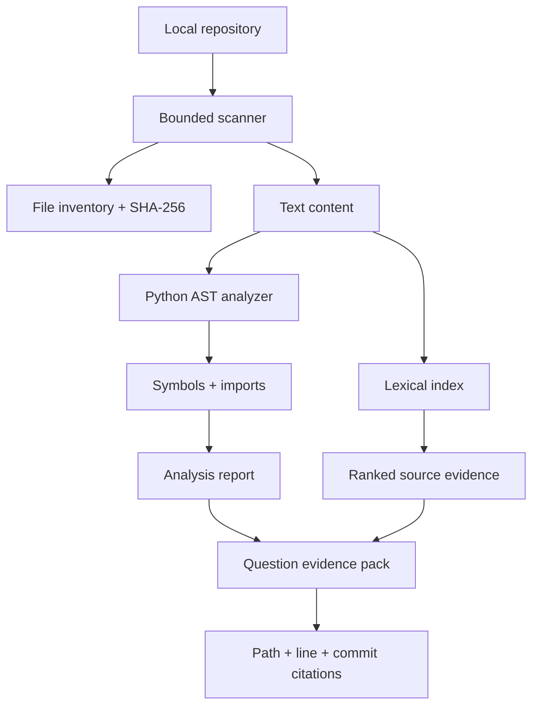

# RepoAtlas AI

> **Understand any codebase. Follow the evidence. Make safer engineering decisions.**

[](https://github.com/archivesofkrish/repoatlas-ai/actions/workflows/ci.yml)
[](https://www.python.org/)
[](LICENSE)

RepoAtlas AI is an evidence-grounded codebase intelligence tool. It scans a repository without executing its code, extracts Python symbols and imports, searches source files, and produces line-addressable evidence packs for engineering questions.

**Current release:** `0.1.0` — working read-only foundation. Retrieval is deterministic and lexical; the project does not yet call an LLM or claim semantic understanding.

## Why RepoAtlas?

Reading an unfamiliar repository is slow. Exact text search helps find names, but it does not explain what is connected, where an implementation lives, or which source lines support an answer. RepoAtlas combines bounded repository discovery, static structure extraction, and evidence-first retrieval so developers can investigate code with a trail they can verify.

## Features in this release

- **Safe repository scanning:** bounded file count and byte limits; skips generated directories, symlinks, unsupported formats, binary files, and common secret-bearing filenames.
- **Python structure extraction:** discovers classes, functions, nested definitions, docstrings, and imports using `ast` without importing project modules.
- **Revision awareness:** records the Git commit SHA when analysing a Git checkout.
- **Evidence search:** deterministic lexical ranking returns source excerpts with file paths and line ranges.
- **Question evidence packs:** packages relevant excerpts, scores, reasons, commit provenance, and explicit limitations. No ungrounded LLM narrative is generated.
- **Credential hygiene:** redacts several common secret patterns from evidence excerpts. This is a defence-in-depth heuristic, not a secret scanner guarantee.
- **CLI and optional API:** use locally from the terminal or expose a small FastAPI service restricted to a configured repository root.
- **Automated tests and CI:** unit tests cover scanning, AST extraction, retrieval, citation validation, redaction, and CLI behaviour; GitHub Actions targets Python 3.11–3.13.

## Quick start

Requires Python 3.11 or newer.

```bash
git clone https://github.com/archivesofkrish/repoatlas-ai.git
cd repoatlas-ai

python -m venv .venv
source .venv/bin/activate       # Windows: .venv\\Scripts\\activate
python -m pip install --upgrade pip
pip install -e '.[dev]'

repoatlas scan .
repoatlas search . "authentication token validation" --top-k 8
repoatlas ask . "Where are repository files scanned?"
```

No API key, external service, database, or network access is required for the core CLI.

## Commands

### Scan a repository

```bash
repoatlas scan PATH
repoatlas scan PATH --json
```

Prints file inventory, Python symbols, imports, warnings, excluded-file counts, aggregate sizes, and Git revision metadata.

### Search source evidence

```bash
repoatlas search PATH "query terms" --top-k 8
```

Returns ranked, line-addressable snippets. Ranking uses term frequency and inverse document frequency (a lightweight BM25-inspired score); it is not embedding-based semantic retrieval. Identifier splitting allows a query such as `create user` to match `create_user`. The citation points to the best-matching source line; surrounding context is included in the excerpt.

### Build an evidence pack

```bash
repoatlas ask PATH "How does authentication work?" --top-k 6
```

Produces JSON with a question, repository revision, evidence citations, redacted excerpts, and limitations. It is deliberately an evidence pack rather than a pretend AI answer. A future LLM layer can consume these validated evidence objects.

## Optional HTTP API

Install the API extra:

```bash
pip install -e '.[api]'
REPOATLAS_ROOT=/path/to/workspace uvicorn repoatlas.api:app --host 127.0.0.1 --port 8000
```

The service exposes these endpoints. All project paths are resolved beneath the configured root. This development API is not intended for public exposure without authentication and operational controls.

| Endpoint | Purpose |
|---|---|
| `GET /health` | Health and read-only mode |
| `POST /v1/scan` | Scan a project under the configured root |
| `POST /v1/search` | Retrieve line-addressable evidence |
| `POST /v1/ask` | Create a question evidence pack |

Example:

```bash
curl -s http://127.0.0.1:8000/v1/ask \\
  -H 'content-type: application/json' \\
  -d '{"path":".","question":"Where is scanning implemented?","top_k":5}'
```

**Deployment note:** before exposing the service to a network, add authentication, authorization, rate limiting, request logging controls, and a managed worker boundary. Keep it bound to localhost unless the deployment is secured.

## Architecture



### Source layout

```text
src/repoatlas/
├── analyzer.py   # Git revision + Python AST analysis
├── api.py        # Optional FastAPI endpoints and root confinement
├── cli.py        # scan, search, ask commands
├── models.py     # typed report, symbol, file, and hit models
├── qa.py         # evidence-pack assembly and citation validation
├── scanner.py    # bounded, read-only file discovery
├── search.py     # deterministic lexical retrieval
└── security.py   # heuristic secret detection and redaction
```

## Safety model and limitations

RepoAtlas treats repository content as untrusted input.

- It **does not import or execute project code** during scanning or static analysis.
- It does not follow directory symlinks; file symlinks are excluded.
- Default scan limits are 20,000 files, 1 MB per file, and 100 MB total content.
- Common generated directories and sensitive filenames such as `.env` are excluded.
- The API resolves requested paths under `REPOATLAS_ROOT` and rejects path traversal.
- Citations are revision-aware and can be checked against the indexed snapshot.
- Secret detection is pattern-based and incomplete. Do not point RepoAtlas at sensitive code unless your data-handling requirements permit it.
- Python AST analysis cannot reveal dynamic imports, runtime call paths, reflection, or behaviour that only appears during execution.
- Other languages are currently inventoried and searchable as text, but do not yet have language-specific symbol graphs.
- Lexical retrieval can miss relevant code expressed with different terminology. A lack of results is not proof that a behaviour is absent.

See [SECURITY.md](SECURITY.md) for the reporting policy and [CONTRIBUTING.md](CONTRIBUTING.md) for engineering standards.

## Testing and quality

```bash
pytest -q
ruff check src tests
```

Tests use temporary repositories and synthetic fixtures; no external project or credential is needed. CI runs the test and lint suite on Python 3.11, 3.12, and 3.13.

## Roadmap

| Stage | Target | Status |
|---|---|---|
| 1 | Safe scanner, Python symbols, lexical search, evidence packs, CLI, local API, tests, CI | **Implemented foundation** |
| 2 | Tree-sitter multi-language parsing and dependency graph | Planned |
| 3 | Hybrid lexical + vector + graph retrieval and evaluation benchmark | Planned |
| 4 | LLM provider abstraction with claim-to-citation validation | Planned |
| 5 | Change-impact analysis, test mapping, and guided engineering investigations | Planned |
| 6 | Secure team workspaces, incremental indexing, and IDE/CI integrations | Planned |

The next milestone is a high-quality evaluation corpus and structural dependency graph. LLM generation comes after retrieval and citation quality can be measured.

## Contributing

Bug reports and pull requests are welcome. Please include tests, discuss security implications, and keep documentation honest about what is implemented versus planned. See [CONTRIBUTING.md](CONTRIBUTING.md).

## License

MIT — see [LICENSE](LICENSE).

---

**RepoAtlas AI's central promise:** the goal is not to make AI sound like it understands a codebase. The goal is to make its understanding inspectable.
