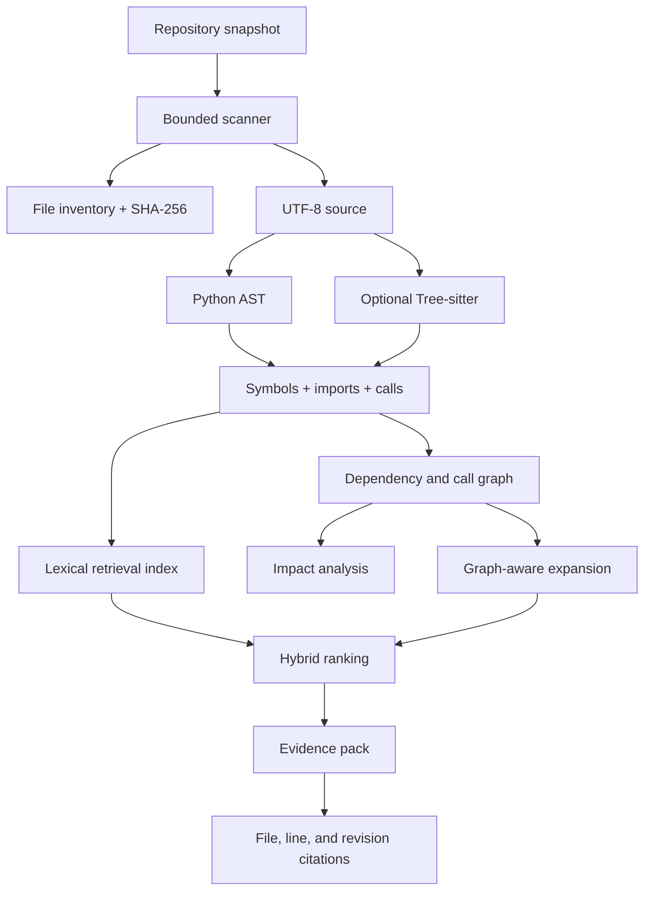

# RepoAtlas AI

> **Understand any codebase. Follow the evidence. Make safer engineering decisions.**

[](https://github.com/archivesofkrish/repoatlas-ai/actions/workflows/ci.yml)
[](https://www.python.org/)
[](LICENSE)

RepoAtlas AI is a read-only codebase intelligence workbench. It inventories repositories, extracts source structure, builds dependency and call-reference graphs, retrieves line-addressable evidence, and estimates the files affected by a change. It is designed around a simple rule: engineering explanations should be inspectable against the exact source that produced them.

**Current release:** `0.9.0` — adds configurable architecture guardrails with CLI, API and standalone HTML reporting to content-addressed source analysis, package topology, change-impact review, evidence retrieval and grounded answers.

## Why RepoAtlas?

Understanding a large or unfamiliar repository is expensive. Search can find text but not reliably explain module relationships. A language model can produce fluent explanations but may miss files, mix revisions, or invent implementation details. RepoAtlas combines deterministic code analysis and source evidence so developers can answer questions and investigate changes with a verification trail.

## Features

| Capability | Implemented behaviour |
|---|---|
| Bounded repository scanner | Reads regular UTF-8 text files under file-count and byte limits; excludes generated folders, common cloud/CLI credential stores, sensitive filenames, symlinked path components, and binary content |
| Content-addressed snapshots | Captures each source file once; analysis and retrieval share the same in-memory contents, file hashes, and snapshot fingerprint |
| Python analysis | Uses the standard-library AST to extract classes, functions, nested definitions, imports, calls, and docstrings without importing project modules |
| Multi-language analysis | Optional Tree-sitter adapters for JavaScript, TypeScript, Go, Rust, Java, C, C++, Ruby, and C# |
| Dependency graph | Builds file import edges and best-effort symbol call-reference edges with source line provenance |
| Change-impact analysis | Traverses reverse, statically resolved import relationships to find likely dependent files |
| Change review workbench | Compares a Git base reference with the working tree, traces dependants, and renders an interactive offline impact dashboard |
| Architecture intelligence | Detects statically resolved dependency cycles, package boundaries, isolated files and high fan-in/fan-out modules; quantifies cross-package coupling and cycle concentration |
| Interactive architecture observatory | Switches between a module dependency map and a package topology map, with contextual package metrics and module inspection in self-contained offline HTML |
| Architecture guardrails | Evaluates allowed/forbidden package dependencies, cross-package import caps and cycle policy; emits evidence-backed JSON or offline HTML findings |
| Lexical retrieval | Ranks files and source lines with deterministic term-frequency/inverse-document-frequency scoring |
| Hybrid retrieval | Expands lexical matches through resolved import relationships, with explicit graph provenance and bounded depth |
| Evidence packs | Returns file path, line range, commit SHA, content hash, snapshot fingerprint, excerpt, match reason, and explicit retrieval limitations |
| Grounded LLM answers | Optional provider-backed claims must cite retrieved evidence IDs; each source citation is checked for path, line range, and hash freshness before output |
| Credential hygiene | Excludes common sensitive filenames and redacts several common token patterns in returned excerpts |
| Interfaces | CLI and optional FastAPI service with scan, lexical/hybrid search, ask, graph, and impact endpoints |

The multi-language parser is an optional capability. Install and cache grammars explicitly; repository scans do not download parser code or execute project code.

## Engineering audit

The current source-level review, confirmed risks, mitigations and follow-up priorities are recorded in [the engineering audit](docs/ENGINEERING_AUDIT_2026-11-16.md). CI status is tracked separately by GitHub Actions; historical green runs are not validation of unmerged changes.

## Quick start

Requires Python 3.11 or newer.

```bash
git clone https://github.com/archivesofkrish/repoatlas-ai.git
cd repoatlas-ai

python -m venv .venv
source .venv/bin/activate       # Windows: .venv\\Scripts\\activate
python -m pip install --upgrade pip
pip install -e '.[dev,api]'
# Optional: only needed for provider-backed natural-language answers
pip install -e '.[llm]'
```

Download the grammars you plan to analyse. This is an explicit setup action:

```bash
python -c "from tree_sitter_language_pack import download; download(['javascript', 'go', 'rust', 'java'])"
```

Then analyse any repository:

```bash
repoatlas scan /path/to/repository
repoatlas search /path/to/repository "authentication token validation" --top-k 8
repoatlas hybrid-search /path/to/repository "authentication token validation" --top-k 8
repoatlas ask /path/to/repository "Where is authentication implemented?"
# Optional; requires OPENAI_API_KEY and the llm extra
repoatlas answer /path/to/repository "How does authentication work?"
repoatlas graph /path/to/repository
repoatlas impact /path/to/repository src/core/auth.py
repoatlas review /path/to/repository --base-ref main
repoatlas guard /path/to/repository --policy ./architecture-policy.json
```

The core scanner and Python AST analyser use the Python standard library. Tree-sitter grammars are downloaded only by the explicit command above (or an equivalent operator-managed setup step).

## CLI reference

### Scan

```bash
repoatlas scan PATH
repoatlas scan PATH --json
```

Produces a file inventory, symbol list, import and call references, excluded-file counts, warnings, and Git revision.

### Search

```bash
repoatlas search PATH "query terms" --top-k 8
```

Returns ranked source excerpts with exact file paths and best-matching line numbers. Identifier splitting allows a query such as `create user` to match `create_user`. Ranking is deterministic lexical retrieval, not embedding-based semantic search.

### Hybrid search

```bash
repoatlas hybrid-search PATH "session token expiry" --top-k 8 --graph-depth 2
```

Hybrid search starts with lexical matches and expands through statically resolved import edges. It can surface consumers and dependencies that do not directly match the query. Graph-expanded results are explicitly labelled, cite a real line in the related file, and include the import location that established the relationship. The default depth is two hops; allowed depth is one to three. The score combines normalised lexical relevance (65% by default) with decayed graph proximity (35%). This is structural context, not semantic understanding or proof of runtime reachability.

### Ask

```bash
repoatlas ask PATH "How does authentication work?" --top-k 6
```

Creates a JSON evidence pack without calling an external model. Use this command when you want retrieval-only output or need to inspect exactly what RepoAtlas found.

### Grounded answer (optional)

```bash
export OPENAI_API_KEY="..."
# Optional model override; default: gpt-6.1-sol
export REPOATLAS_OPENAI_MODEL="gpt-6.1-sol"
repoatlas answer PATH "How does authentication work?" --top-k 6
```

The answer feature is opt-in and uses the OpenAI Responses API with strict JSON-schema output. It sends the question and only the retrieved, secret-redacted evidence excerpts (up to 2,400 characters per excerpt), not the entire repository. It makes no provider request when no evidence is found. Every generated claim must reference one to five evidence IDs from the returned evidence pack; RepoAtlas rejects unknown IDs and re-checks source containment, line bounds, and the cited file's SHA-256 after generation.

This verifies citation provenance and freshness, **not semantic entailment**. A valid citation does not prove that the model's statement is fully supported by the cited lines. Review generated claims before relying on them. Retrieved source is treated as untrusted data, and the model receives no tools or repository access. Requests set `store=False`; this is not a substitute for reviewing the provider's current data controls.

See [docs/LLM_SAFETY.md](docs/LLM_SAFETY.md) for the threat model and data-flow details.

### Graph

```bash
repoatlas graph PATH
```

Outputs graph nodes, import edges, call-reference edges, resolution flags, and aggregate counts. Unresolved references remain visible instead of being silently treated as confirmed internal dependencies.

### Impact

```bash
repoatlas impact PATH path/to/module.py --max-depth 5
```

Traverses reverse resolved-import edges and reports direct and transitive dependants. This is a static estimate, not a guarantee of runtime blast radius.

### Change review workbench

Run from a checked-out feature branch and compare it with main:

    repoatlas review PATH --base-ref main
    repoatlas review PATH --base-ref origin/main --output ./artifacts/change-review.html
    repoatlas review PATH --base-ref main --json

The review compares the base commit with the current working tree, including committed changes, staged/unstaged tracked changes, and non-ignored untracked files. It scans the current checkout, traces changed modules through resolved import dependants, and presents changed paths, attention tiers, direct/transitive dependants, graph coverage, and limitations in a self-contained dashboard. The responsive, dark-themed HTML works offline and includes path search, attention filters, a dependency map, a per-file inspector and JSON export.

Attention tiers are a triage aid based on the number of statically identified dependants (High: 10+, Elevated: 4–9, Focused: 1–3, Local: 0). They are not defect probabilities. Deleted or excluded files are marked Unmapped because they are absent from the current source graph. Dynamic imports, reflection, generated code and runtime wiring are not modelled.

The optional HTTP service exposes the same analysis at POST /v1/review.

### Architecture explorer

```bash
# Generate a standalone HTML explorer inside the repository
repoatlas architecture PATH

# Choose an output path or request JSON metrics
repoatlas architecture PATH --output ./artifacts/architecture.html
repoatlas architecture PATH --json
```

The report includes file-level fan-in/fan-out, structural hotspots, top-level package boundaries, isolated files and strongly connected components (static import cycles). The HTML explorer is self-contained and works offline: search paths, filter by language or package, select a module to inspect its dependencies/dependants, and pan or zoom the graph. The visual map prioritises the most structurally connected modules when a repository is large; the JSON/API report retains all scanned file metrics. A cycle or high structural score is a review signal, not proof of a defect or a maintainability score.


### Architecture guardrails

Create a JSON policy describing package boundaries and coupling limits:

```json
{
  "schema_version": 1,
  "name": "Layered application",
  "allowed_package_dependencies": {
    "api": ["application", "domain"],
    "application": ["domain", "shared"],
    "domain": ["shared"]
  },
  "forbidden_package_dependencies": [
    {"source": "api", "target": "infrastructure", "reason": "Use application services instead."}
  ],
  "max_cross_package_imports": {"api": 40},
  "fail_on_cycles": true
}
```

Run the policy and produce machine-readable findings or a styled offline report:

```bash
repoatlas guard PATH --policy ./architecture-policy.json --json
repoatlas guard PATH --policy ./architecture-policy.json --output ./artifacts/guardrails.html
```

Findings include package relationships and up to five representative source-to-target file imports. PASS means no configured rule was violated by the observed static graph; it does not prove runtime architectural correctness. Policy files are JSON data, not executable configuration.

## Optional HTTP API

Install the API extra and start the service with an explicit workspace root:

```bash
pip install -e '.[api,parsing]'
REPOATLAS_ROOT=/path/to/workspace uvicorn repoatlas.api:app --host 127.0.0.1 --port 8000
```

| Endpoint | Purpose |
|---|---|
| `GET /health` | Health and read-only mode |
| `POST /v1/scan` | Scan a repository under the configured root |
| `POST /v1/search` | Retrieve line-addressable lexical evidence with snapshot and content-hash metadata |
| `POST /v1/hybrid-search` | Retrieve lexical evidence plus bounded import-graph context |
| `POST /v1/ask` | Create a question evidence pack without calling a model |
| `POST /v1/answer` | Optional provider-backed answer with evidence-ID and citation validation |
| `POST /v1/graph` | Build dependency and call-reference graph |
| `POST /v1/impact` | Estimate likely file impact |
| `POST /v1/architecture` | Return package boundaries, dependency cycles, isolated files and structural hotspots |
| `POST /v1/architecture/guardrails` | Evaluate supplied architecture rules against the repository's static package graph |

Example graph request:

```bash
curl -s http://127.0.0.1:8000/v1/graph \\
  -H 'content-type: application/json' \\
  -d '{"path":"my-project"}'
```

The API confines requested paths to `REPOATLAS_ROOT`, rejects non-finite hybrid-search weights, validates bounded request fields, and exposes structured architecture intelligence at `POST /v1/architecture`. It is a local development interface, not a production multi-tenant service. Add authentication, authorization, rate limits, worker isolation, and operational controls before network exposure. The `/v1/answer` route requires the optional `llm` dependency and `OPENAI_API_KEY`; only retrieved, redacted excerpts and the question are sent to the provider.

## Architecture



### Source layout

```text
src/repoatlas/
├── analyzer.py   # Snapshot-based Python AST and multi-language integration
├── git.py        # Bounded Git revision lookup
├── api.py        # FastAPI routes and root confinement
├── cli.py        # scan, search, hybrid-search, ask, graph, impact
├── graph.py      # Dependency graph and transitive impact analysis
├── hybrid.py     # Bounded lexical + dependency-graph retrieval
├── llm.py        # Optional provider adapter and citation-checked claims
├── models.py     # Typed repository and analysis models
├── parsing.py    # Optional Tree-sitter language adapters
├── qa.py         # Evidence-pack assembly and citation validation
├── scanner.py    # Bounded scanner and content-addressed snapshot capture
├── search.py     # Deterministic lexical retrieval
└── security.py   # Heuristic secret detection and redaction
```

## Safety model and known limitations

RepoAtlas treats repository content as untrusted input.

- It does **not** import or execute repository code during scanning or static analysis.
- It does not follow directory symlinks; file symlinks are excluded.
- Default scan limits are 20,000 files, 1 MB per file, and 100 MB total content.
- Each analysis or retrieval operation captures one bounded in-memory snapshot; parsing, ranking, graph expansion, and excerpts use the same captured text instead of re-reading files.
- Snapshot fingerprints are derived from relative paths and SHA-256 file hashes. Citations include the file hash and are rejected when the corresponding source content changes.
- Common generated directories, sensitive filenames such as `.env`, and credential stores such as `.aws`, `.ssh`, and `.config/gcloud` are excluded.
- Tree-sitter grammar installation is explicit. A scan never downloads a grammar. Each file is capped at 1 MB, parsing has a time limit, and syntax traversal is bounded by node-count and depth limits.
- The API resolves paths beneath `REPOATLAS_ROOT` and rejects path traversal. Architecture metrics only count statically resolved imports. Strongly connected components indicate static cycles but do not prove runtime defects. The HTML graph is capped to the highest structural-score files when the repository is large; the structured report remains complete.
- Secret detection is heuristic and incomplete. It cannot guarantee that every credential has been removed.
- Language grammars expose different syntax trees. The generic adapter captures common definitions, imports, and calls but does not promise complete language-semantic understanding.
- Import resolution is best-effort. Dynamic imports, macros, generated code, module aliases, build-system rules, dependency injection, and runtime reflection are not fully modelled.
- Call-reference edges are best-effort and are marked resolved only when a unique declaration exists in the same source file; cross-file name-only matches remain unresolved.
- Impact analysis follows statically resolved file imports only; it is not a complete runtime blast-radius calculation.
- The `search` command and `/v1/search` endpoint use lexical retrieval. `hybrid-search` adds import-graph context but can only expand from a lexical seed and only across resolved static imports; it does not provide embedding-based semantic recall.
- The optional `answer` command and `/v1/answer` endpoint send the question and retrieved, redacted snippets to the configured provider. They do not send the entire repository. Do not enable this feature for proprietary source unless your organisation has approved the provider and its data controls.
- Citation checks establish that evidence IDs map to files and lines whose content hash is still current. They do not prove that a generated claim is logically entailed by those lines; human review remains required.
- Prompt-injection attempts inside repository content are treated as untrusted data, but prompt-injection resistance cannot be guaranteed.

See [SECURITY.md](SECURITY.md) for reporting guidance and [CONTRIBUTING.md](CONTRIBUTING.md) for engineering standards.

## Testing and quality

```bash
ruff check src tests benchmarks
pytest --cov=repoatlas --cov-report=term-missing --cov-fail-under=80
python benchmarks/evaluate_retrieval.py --top-k 5
```

The checked-in four-scenario synthetic benchmark compares lexical-only and hybrid retrieval using MRR@k, Recall@k, and nDCG@k. It includes implementation, API consumer, downstream workflow, and decoy files for password registration, tenant scoping, credential revocation, and role-based permissions. It is a reproducible regression harness, not a claim of general performance on arbitrary repositories. See [benchmarks/README.md](benchmarks/README.md) for the dataset and metric definitions.

CI runs on Python 3.11, 3.12, 3.13, and 3.14. It validates the configured grammar names against the published Tree-sitter manifest, caches those grammars, runs Ruff, and executes the test suite with an enforced 80% coverage floor.

The tests use temporary repositories and synthetic source fixtures; no personal or proprietary code is required.

## Roadmap

| Stage | Capability | Status |
|---|---|---|
| 1 | Safe scanner, Python AST, lexical evidence packs, CLI, local API, tests, CI | Implemented |
| 2 | Tree-sitter multi-language parsing, import/call graph, transitive impact | Implemented |
| 3 | Hybrid retrieval, graph-aware ranking, benchmark corpus, retrieval evaluation | Implemented |
| 4 | Optional provider-backed answers with strict structured output and citation provenance checks | Implemented; semantic entailment remains unverified |
| 5 | Interactive architecture explorer, module inspector, dependency cycles and package metrics | Implemented in 0.6.0 |
| 6 | Incremental indexing, secure workspaces, and CI/IDE integrations | Planned |

Generative answers are optional and separated from retrieval-only evidence packs. Provenance validation is implemented; semantic claim-to-source entailment still requires independent evaluation and human review.

## Contributing

Bug reports and pull requests are welcome. Contributions should include tests, document limitations, and preserve the read-only default. See [CONTRIBUTING.md](CONTRIBUTING.md).

## License

MIT — see [LICENSE](LICENSE).

---

**RepoAtlas AI's central promise:** the goal is not to make AI sound like it understands a codebase. The goal is to make its understanding inspectable.
